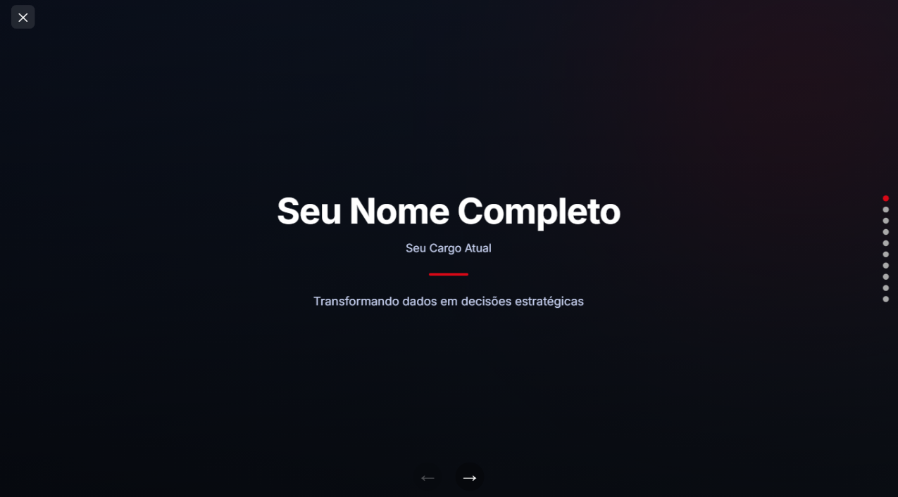

# 📊 Data Portfolio — Presentation Template

<div align="center">



**Um template de portfólio profissional para analistas e cientistas de dados.**  
Construído com HTML, CSS e JavaScript puro — sem dependências, sem build step.

[](LICENSE)
[](#)
[](#)
[](#)
[](CONTRIBUTING.md)

[Demo ao Vivo](#) · [Como Usar](#como-usar) · [Personalizar](#personalização) · [Contribuir](CONTRIBUTING.md)

</div>

---

## ✨ Funcionalidades

- 🖥️ **Modo apresentação desktop** — layout 1366×768px com scaler automático para qualquer resolução
- 📱 **Totalmente responsivo** — versão mobile com scroll vertical nativo e navegação fixada
- 🎨 **10 slides pré-configurados** — capa, sobre mim, trajetória, experiências, projetos, formação, hobbies e encerramento
- ⌨️ **Atalhos de teclado** — setas para navegar, `F` para fullscreen
- 👆 **Suporte a touch/swipe** — funciona em tablets e celulares
- 🔗 **Links de certificações** — cada certificado linka diretamente para o badge verificável
- ⚡ **Zero dependências** — apenas `lucide` via CDN (opcional)
- 🌗 **Paleta de cores customizável** — variáveis CSS centralizadas

---

## 📸 Prévia dos Slides

| Slide | Descrição |
|-------|-----------|
| `00` | Capa com nome e tagline |
| `01` | Sobre mim — foto, perfil, habilidades |
| `02` | Trajetória profissional (timeline) |
| `03` | Experiência principal |
| `04` | Experiência anterior |
| `05` | Projeto de dados (educacional) |
| `06` | Projeto de dados (corporativo) |
| `07` | Formação & certificações |
| `08` | Além dos dados (voluntariado, esportes) |
| `09` | Encerramento com contatos |

---

## 🚀 Como Usar

### 1. Clone o repositório

```bash
git clone https://github.com/seu-usuario/data-portfolio-template.git
cd data-portfolio-template
```

### 2. Substitua os assets

Coloque seus arquivos na pasta `assets/`:

```
assets/
├── IMG.jpg                        # Sua foto de perfil (preferencialmente quadrada)
├── favicon.png                    # Ícone da aba do browser
├── github.png                     # Ícone do GitHub (branco, fundo transparente)
├── linkedin.png                   # Ícone do LinkedIn (branco, fundo transparente)
├── senac-logo.png                  # Logo da sua instituição de ensino
├── itau-logo.png                   # Logo da empresa 1
├── logo-parceiros.png              # Logo da empresa 2
├── felipe-itau.JPEG                # Foto na empresa 1
├── imagem-parceiros.jpeg           # Foto na empresa 2
├── image.png                       # Screenshot do dashboard (projeto 1)
├── escrevendo_na_quarentena_logo.jpg  # Logo do voluntariado
├── logo-kapiva.png                 # Logo da atlética/hobbie
└── [certificados].png              # Logos dos certificados
```

### 3. Edite o conteúdo

Abra o `index.html` e substitua os textos. Veja a seção [Personalização](#personalização) para um guia detalhado.

### 4. Abra no browser

```bash
# Sem servidor (simples)
open index.html

# Com servidor local (recomendado)
npx serve .
# ou
python3 -m http.server 8000
```

---

## 🎨 Personalização

### Cores

Todas as cores ficam no bloco `:root` no topo do CSS:

```css
:root {
  /* Suas cores pessoais */
  --felipe-red:   #d80816;
  --felipe-blue:  #0e1d8c;
  --felipe-yellow:#feed08;

  /* Empresa 1 (ex: Itaú) */
  --itau-orange:  #FF6200;
  --itau-graphite:#2D3238;

  /* Empresa 2 (ex: Parceiros) */
  --parceiros-blue1: #254a91;
  --parceiros-yellow:#ffaf00;
}
```

Troque pelos hex das cores das empresas onde você trabalhou ou das suas cores de marca pessoal.

### Conteúdo dos slides

Cada slide é um `<section class="slide ...">` para desktop e um `<div class="m-slide ...">` para mobile. Edite os dois para manter consistência.

**Exemplo — trocar nome e cargo:**

```html
<!-- Desktop -->
<h1 class="final-title">Seu Nome Aqui</h1>
<p class="final-subtitle">Seu Cargo</p>

<!-- Mobile -->
<h1 class="m-cover-title">Seu Nome Aqui</h1>
<p class="m-cover-sub">Seu Cargo</p>
```

### Adicionar/remover slides

1. **Desktop**: adicione um `<section class="slide ...">` dentro de `#slider`
2. **Mobile**: adicione um `<div class="m-slide ..." data-slide="N">` dentro de `#mobile-view`
3. Certifique-se de que os `data-slide` são sequenciais (0, 1, 2...)

O JavaScript conta os slides automaticamente.

### Links de contato

No slide de encerramento:

```html
<a href="https://github.com/seu-usuario" target="_blank" class="contact-icon">
  
</a>
<a href="https://linkedin.com/in/seu-perfil" target="_blank" class="contact-icon">
  
</a>
```

---

## 📁 Estrutura do Projeto

```
data-portfolio-template/
│
├── index.html          # Arquivo principal (tudo em um único arquivo)
├── assets/             # Imagens, logos e ícones
│   └── ...
│
├── README.md           # Este arquivo
├── CONTRIBUTING.md     # Guia de contribuição
├── LICENSE             # Licença MIT
└── .gitignore          # Arquivos ignorados pelo Git
```

> O projeto é intencionalmente um **único arquivo HTML** para facilitar o deploy e o compartilhamento (basta enviar o `index.html` + pasta `assets`).

---

## 🌐 Deploy

### GitHub Pages (gratuito)

1. Suba o repositório para o GitHub
2. Vá em **Settings → Pages**
3. Em *Source*, selecione `main` / `root`
4. Acesse `https://seu-usuario.github.io/data-portfolio-template`

### Netlify (arrastar e soltar)

1. Acesse [netlify.com/drop](https://app.netlify.com/drop)
2. Arraste a pasta do projeto
3. Pronto — URL gerada automaticamente

### Vercel

```bash
npx vercel --prod
```

---

## 🤝 Contribuindo

Contribuições são muito bem-vindas! Veja o guia completo em [CONTRIBUTING.md](CONTRIBUTING.md).

**Ideias de contribuição:**
- Novos temas de cores
- Variante de slide para projetos de ML/BI
- Animações de entrada nos slides
- Versão com modo escuro nativo
- Tradução para inglês/espanhol

---

## 📄 Licença

Distribuído sob a licença MIT. Veja [LICENSE](LICENSE) para mais detalhes.

Feito com ❤️ por [Felipe Matos Oliveira](https://linkedin.com/in/felipe-matoss)
